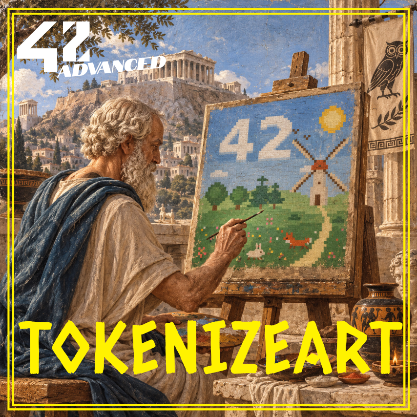

<p align="center">
  
</p>

> [!IMPORTANT]
> **Deployment**
> - **Network:** Ethereum Sepolia testnet
> - **Contract:** `0x45DEDC83B233B846F6FED1a118d71bEEffAE0f97`
> - **Etherscan:** [https://sepolia.etherscan.io/token/0x45DEDC83B233B846F6FED1a118d71bEEffAE0f97](https://sepolia.etherscan.io/token/0x45DEDC83B233B846F6FED1a118d71bEEffAE0f97)

## 🚀 SYNOPSIS

`tokenizeArt` is the 42 project about NFTs: create a non-fungible token whose image shows a legible **42**, store that image on **IPFS**, deploy the contract on a public blockchain, mint, and prove ownership.

**Windmill42** is an **ERC-721** contract written in **Solidity** with **OpenZeppelin**. Every token shows the same 64×64 pixel artwork, *Spring Meadow*: a windmill in a flowered meadow, under a sky where the clouds draw a big **42**.

The artwork is stored **twice**:
- **On IPFS:** the PNG is pinned with Pinata, and wallets display it.
- **On-chain (bonus):** the contract rebuilds the same image as an SVG from compressed pixel data. Its metadata (`tokenURI`) is also built on-chain, so no server is needed.

Everything runs from one Docker image:
- a **Python** deployment script (`web3.py`),
- a terminal minting app (TUI, built with Rich),
- a small **minting website** connected to MetaMask (bonus).

## ✨ FEATURES

- **ERC-721 NFT** (OpenZeppelin `ERC721` + `Ownable`): `ownerOf`, transfers, approvals, all standard.
- **42 tokens maximum**, minted only by the contract owner, with IDs 1 to 42.
- **Metadata:** name `Windmill42 #<id>`, artist `flverge`, title *Spring Meadow*, edition `<id>/42`.
- **IPFS image** (CID `bafkreictfou6ncwuojw6dp3n7edozfmrr5c7gn7ojbxtz3bbz3opyqxjfu`), reached through an https gateway that the owner can replace if it ever closes.
- **On-chain image:** `svgImage()` returns the artwork, pixel for pixel identical to the IPFS file (tests prove it).
- **Deployment script:** checks the configuration, compiles, estimates the cost, deploys, and saves the address.
- **Mint TUI:** mint, `ownerOf`, `tokenURI`, draws the image in the terminal, compares IPFS with on-chain, and includes security demos.
- **Website:** MetaMask connection; shows both images; mint; look up any token.

## 👀 SEE IT IN METAMASK

1. Open MetaMask and select the **Sepolia** network (*Show test networks* must be on).
2. Open the **NFTs** tab, then **Import NFT**.
3. Paste the contract address from the box above and the token ID `1`, then click **Import**.
4. *Windmill42 #1* appears with its image.

You can also open the token on Etherscan (link above) or look it up on the website.

## 🤔 WHY THESE CHOICES

| Choice | Why |
|---|---|
| **Ethereum Sepolia** | The recommended Ethereum testnet: same Proof-of-Stake rules and tools as mainnet, free test ETH from faucets, supported by MetaMask and Etherscan. |
| **ERC-721** | The standard for *non-fungible* tokens: each token has its own ID and a single owner (`ownerOf`). Wallets and marketplaces know it, so no custom integration is needed. |
| **Solidity + OpenZeppelin** | Solidity is Ethereum's main language. OpenZeppelin's audited `ERC721` and `Ownable` give the standard behaviour and the owner-only access control, with no hand-written security code. |
| **Python + web3.py (no Hardhat)** | Same toolchain as my previous project `tokenizer`. `py-solc-x` compiles, `web3.py` signs locally and sends, and `pytest` + `eth-tester` test on a local chain. Every step is visible in plain Python. |
| **IPFS + Pinata** | IPFS addresses a file by its content (the CID), so the image cannot be swapped silently. Pinata keeps it available ("pinning") and provides gateways. |
| **IPFS *and* on-chain** | IPFS is what the subject asks for and what wallets display. The on-chain SVG (bonus) keeps the art alive even if every gateway closes. That is not hypothetical: `ipfs.io` closed in September 2026, see [3_artwork_and_ipfs](documentation/3_artwork_and_ipfs.md). |

More details: [documentation/1_technical_choices.md](documentation/1_technical_choices.md).

## 🛠️ QUICKSTART

**Prerequisites:** Docker with Docker Compose, a MetaMask wallet with some Sepolia ETH, and a free Pinata account (only to pin the image again).

```bash
cp .env.example .env        # then fill in PRIVATE_KEY (and PINATA_JWT to pin)
docker compose build
docker compose run --rm tokenizeart
```

Inside the container:

```bash
python mint/pin_to_ipfs.py      # optional: the image is already pinned (mint/ipfs.json)
python deployment/deploy.py     # compile + deploy Windmill42 to Sepolia
python mint/mint_tui.py         # mint, ownerOf, tokenURI, view the art
pytest -q                       # the test suite (local chain, no ETH needed)
```

The website, on the host: `docker compose up website`, then open <http://localhost:8042>.

Step by step: [environment](documentation/2_environment_setup.md) · [deployment](documentation/4_deployment_guide.md) · [TUI](documentation/5_minting_tui.md) · [website](documentation/6_website.md).

## 🗂️ PROJECT STRUCTURE

```
code/            Smart contract (subject: "code")
  Windmill42.sol         the ERC-721 contract
  Windmill42Art.sol      library that rebuilds the SVG on-chain
  Windmill42ArtData.sol  the artwork as compressed pixel data
  tests/                 contract tests (pytest + local chain)
deployment/      Deployment (subject: "deployment")
  deploy.py              deploy to Sepolia
  compiler.py            solc 0.8.35 + OpenZeppelin compilation
  artifacts/             address + ABI of the latest deployment
mint/            Minting (subject: "mint")
  art/                   windmill42.png / .svg, the artwork
  ipfs.json              CID of the pinned image
  pin_to_ipfs.py         upload the image to IPFS (Pinata)
  mint_tui.py            terminal minting app
  nft_client.py          contract client used by the TUI
  website/               minting website (HTML/JS + MetaMask)
documentation/   Documentation (subject: "documentation")
plans/           Design notes and implementation plan
```

## 📚 DOCUMENTATION

1. [Technical choices](documentation/1_technical_choices.md)
2. [Environment setup](documentation/2_environment_setup.md)
3. [Artwork and IPFS](documentation/3_artwork_and_ipfs.md)
4. [Deployment guide](documentation/4_deployment_guide.md)
5. [Minting TUI](documentation/5_minting_tui.md)
6. [Website](documentation/6_website.md)
7. [Contract reference](documentation/7_contract_reference.md)
8. [Security model](documentation/8_security_model.md)
9. [Defense walkthrough](documentation/9_defense_walkthrough.md)

## 🔒 SECURITY IN SHORT

- No private key, Pinata key or API key is committed. They live only in the gitignored `.env`, and a test scans the repository for leaks.
- Only the owner can mint. The 43rd mint reverts. Transactions are signed locally: the node never sees the key.
- The website never sees a key: MetaMask signs.

Details: [8_security_model.md](documentation/8_security_model.md).

## 🚧 LIMITATIONS

- Testnet only (Sepolia), so the tokens have no monetary value.
- All 42 tokens share the same artwork; only the edition number changes.
- The owner can change the image *gateway*, but never the image itself (its CID is fixed).
- `svgImage()` and `tokenURI()` are heavy read calls (about 4.4M and 5.3M gas). They are free, but slow on some nodes.

## 🧑‍💻 AUTHOR

- **Florian VERGE** ([@maitreverge](https://github.com/maitreverge)) – Design, core logic, smart contract development

## 📜 LICENCE

This project is licensed under the **MIT License**, see [LICENSE](LICENSE).
