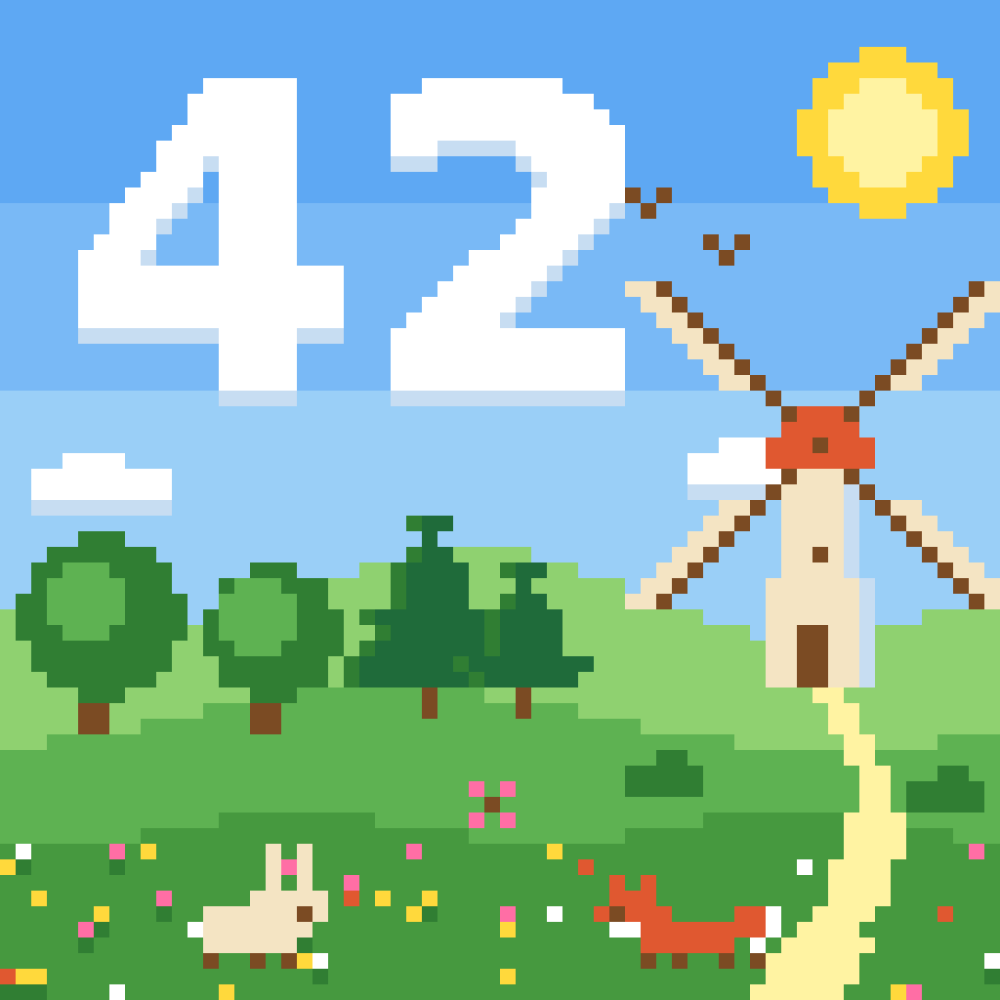

# Artwork and IPFS

## 1. The artwork: *Spring Meadow*

<p align="center"></p>

- **64×64 pixels**, 16 colours, in pixel-art style.
- A windmill with a red cap in a flowered meadow, with trees, a rabbit, a fox and birds, under a blue sky.
- The **42** is drawn by two big clouds, so it is legible at any size, which the subject requires.
- Artist: **flverge**. Title: **Spring Meadow**.

The palette:

`#ffffff` `#c4ddf0` `#9acff8` `#78bbf4` `#5ba8f0` (sky and clouds) · `#ffd93b` `#fff3a0` (sun, path) · `#8fd16f` `#5db34f` `#47993f` `#2f7d32` `#1f6b3a` (grass, trees) · `#7a4a22` (wood) · `#e0582f` (windmill cap, fox) · `#f4e3c1` (windmill wall, rabbit) · `#ff6fa5` (flowers)

### The three files of the same image

| File | Use |
|---|---|
| `mint/art/windmill42.png` | 1024×1024 (each pixel scaled ×16). This is the file pinned on IPFS. |
| `mint/art/windmill42.svg` | the 64×64 vector version, one `<path>` per colour |
| `code/Windmill42ArtData.sol` | the same pixels as run-length data for the contract |

The art was produced once with a generator script. Once the final art was approved, the script was removed and these three files became the source of truth. Tests in `mint/tests/test_art.py` and `code/tests/test_windmill42.py` prove they describe exactly the same pixels:
- the PNG matches the SVG pixel for pixel,
- the contract's `svgImage()` returns the SVG **byte for byte**.

### How the image is stored on-chain

Storing 4,096 pixels one by one would be expensive, so the image is compressed:
- **Palette:** 16 colours × 3 bytes.
- **Runs:** 729 horizontal runs of one colour, 4 bytes each: `[colour, x, y, length]`, sorted by colour.

`Windmill42Art.svg()` turns them into one SVG `<path>` per colour (`M{x} {y}h{n}v1h-{n}z` per run), writing into one pre-sized memory buffer. The result is about 10.7 KB of SVG, computed for free by a read-only call (about 4.4M gas, which nobody pays).

## 2. IPFS in short

IPFS identifies a file by its **content**: the **CID** is a hash of the bytes. Change one pixel and the CID changes. So `ipfs://<CID>` always means *this exact image*, whoever serves it.

Files stay available only while some node keeps ("pins") them. **Pinata** is a pinning service: it keeps our file online and provides http gateways.

## 3. Pinning the image

```bash
python mint/pin_to_ipfs.py
```

1. Reads `PINATA_JWT` from `.env`.
2. Uploads `mint/art/windmill42.png` to Pinata's **public** IPFS network (`POST https://uploads.pinata.cloud/v3/files`).
3. Writes `mint/ipfs.json`:

```json
{
  "file": "mint/art/windmill42.png",
  "sha256": "532ba9e6…e92d",
  "cid": "bafkreictfou6ncwuojw6dp3n7edozfmrr5c7gn7ojbxtz3bbz3opyqxjfu",
  "imageURI": "ipfs://bafkreictfou6ncwuojw6dp3n7edozfmrr5c7gn7ojbxtz3bbz3opyqxjfu",
  "gatewayURL": "https://gateway.pinata.cloud/ipfs/bafkrei…qxjfu"
}
```

The CID is public data (not a secret), so `ipfs.json` is committed. `deploy.py` refuses to deploy if the PNG changed since it was pinned (the `sha256` would not match). Uploading the same file again gives the **same CID**.

## 4. Gateways: how wallets reach IPFS

Browsers and wallets speak http, not IPFS. A **gateway** fetches the file from IPFS and serves it at `https://<gateway>/ipfs/<CID>`.

| Gateway | Status (October 2026) |
|---|---|
| `https://gateway.pinata.cloud/ipfs/<CID>` | ⚠️ shared and unreliable: 6 to 8 s, and sometimes times out (HTTP 404 "timed out searching") |
| `https://<name>.mypinata.cloud/ipfs/<CID>` | ✅ your Pinata dedicated gateway, fast (under 1 s); used by the deployed contract. **Recommended.** |
| `https://inbrowser.link/ipfs/<CID>` | ✅ in a browser: a *service worker* gateway that fetches the blocks straight from IPFS peers, with no Pinata gateway involved. This is a good proof that the file really is on IPFS. |
| `https://ipfs.io/ipfs/<CID>`, `dweb.link` | ❌ closed in September 2026 (HTTP 429, "switching to a service worker gateway only") |

Links to try:
- Pinata's public gateway: <https://gateway.pinata.cloud/ipfs/bafkreictfou6ncwuojw6dp3n7edozfmrr5c7gn7ojbxtz3bbz3opyqxjfu>
- From the IPFS network directly: <https://inbrowser.link/ipfs/bafkreictfou6ncwuojw6dp3n7edozfmrr5c7gn7ojbxtz3bbz3opyqxjfu>

### Why the contract stores a gateway

MetaMask turns `ipfs://` images into `dweb.link` links, and `dweb.link` is closed. A first trial deployment, which used `"image": "ipfs://…"`, showed **no image** in MetaMask.

The contract therefore stores two things:
- `imageCID`: fixed forever.
- `imageGateway`: for example `https://gateway.pinata.cloud/ipfs/`.

The metadata `image` is `imageGateway + imageCID`, an https link to the same IPFS file.

If that gateway closes too, the owner calls `setImageGateway("https://<domain>/ipfs/")`.

`deploy.py` uses `PINATA_GATEWAY` from `.env`, or `gateway.pinata.cloud` when it is empty. Before deploying, it downloads the image once through that link, and stops if the gateway does not answer.
